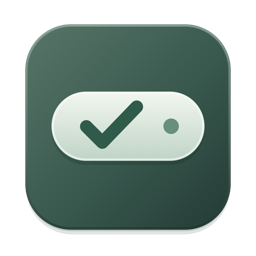

<p align="center">
  
</p>

# 干了吗

**悬在桌面上的 Mac 待办。鼠标移过去，就知道下一件要做什么。**

说一句「明天下午三点交报告」，核对任务和截止时间后保存。需要专注时，从任务旁启动 25 或 50 分钟计时。面板收起后，剩余时间还看得见。

[**下载干了吗 0.6.1**](https://raw.githubusercontent.com/lee73201/ganlema/main/Backups/0.6.1-github-home/ganlema-0.6.1-build11-app.zip) · macOS 14 或更新版本 · 此下载包适用于 Apple 芯片 Mac

## 安装与打开

1. 下载并解压 ZIP，将「干了吗.app」拖入「应用程序」，然后双击打开。
2. 在桌面找悬浮胶囊，或点击屏幕顶部菜单栏的勾号，选择「打开干了吗」。
3. 若 macOS 因无法验证开发者而阻止打开，此构建使用临时签名，未经过 Apple 公证。仅在确认来源为本仓库后，可前往「系统设置 → 隐私与安全性」，在对应提示下选择「仍要打开」（如果系统提供该选项）。

## 怎么用

| 想做什么 | 怎么操作 |
| --- | --- |
| 查看、移动或收起 | 悬停约 250 毫秒展开，移开约 550 毫秒收起。点击胶囊可固定展开，展开后点图钉解锁。拖动胶囊或时钟区域可移动位置，拖动展开窗口边缘或右下角可调整大小。 |
| 写一句话添加 | 在底部输入「明天下午三点交报告，提前半小时提醒」并按回车。检查生成的卡片，再点「确认并保存」。可以用分号分隔多件事。 |
| 说一句话添加 | 点底部麦克风，首次使用时允许麦克风和语音识别。说完点「结束录音」，核对或修改文字，再点「解析待办」并确认保存。 |
| 修改、完成或撤销 | 在列表中点击标题、日期或旗帜即可快速修改。点任务左侧的圆圈标记完成；可在「已完成」恢复。误删任务或打卡时，10 秒内可撤销。 |
| 开启提醒 | 在任务里设置截止时间，勾选提前 1 天、提前 2 小时、到期时或自定义提醒。点面板铃铛查看权限。若通知已关闭，点「打开通知设置」，在 macOS 中为「干了吗」允许通知。 |
| 专注一件事 | 在任务的计时菜单选 25 或 50 分钟。展开时可以暂停、继续或结束，收起后胶囊显示剩余时间。 |
| 记录打卡 | 在「打卡」添加习惯，点击相应日期切换状态。「已完成」按日期汇总完成的待办和已打卡记录。 |
| 调整外观 | 菜单栏勾号 →「悬浮外观设置…」。可以预览并切换五种形状，调整大小、玻璃材质、透明度和展开延时。 |
| 暂时让它离开屏幕 | 若只想收起面板，先解锁图钉，再移开鼠标。若希望桌面连胶囊也不显示，在菜单栏勾号里选「退出干了吗」。下次打开，任务和打卡仍在。 |

### 截止时间越近，提醒越明显

默认尺寸下，展开面板会随最紧迫任务的截止时间分级放大。若手动调整过窗口大小，应用优先保留你的尺寸。可在齿轮菜单关闭「DDL 临近时增大窗口」，也可选「恢复默认窗口大小」重新使用自动尺寸。系统提醒是否显示取决于 macOS 通知权限和专注模式等设置。

### 数据与语音

待办和打卡保存在本机，无需注册账号。文字解析在本机运行，支持常用中文日期、时段和提前提醒。遇到含糊的时间，请在保存前核对卡片。语音转文字使用 Apple 的系统能力，设备支持时优先在本机识别，否则可能由 Apple 联网处理。应用不保存录音文件。

## 从源码构建

这是原生 macOS 应用。界面使用 SwiftUI，悬浮窗和毛玻璃由 AppKit 提供，本地记录使用 SwiftData。安装完整 Xcode 后，在仓库目录运行：

```bash
bash scripts/test.sh
bash scripts/build-app.sh
open "build/干了吗.app"
```

也可以打开 `FocusDock.xcodeproj`，选择 `FocusDock` scheme 运行或测试。源码中的图标矢量稿位于 [Resources/AppIcon.svg](Resources/AppIcon.svg)，应用使用 [AppIcon.icns](Resources/AppIcon.icns)。

- 本机数据库位于 `~/Library/Application Support/FocusDock/`。升级时沿用原应用标识和数据路径，迁移细节见 [MIGRATION.md](MIGRATION.md)。
- [历史版本备份](Backups)与[功能验证记录](VALIDATION-QUALITY-THREE.md)保留在仓库中。应用下载包不包含个人数据库。
