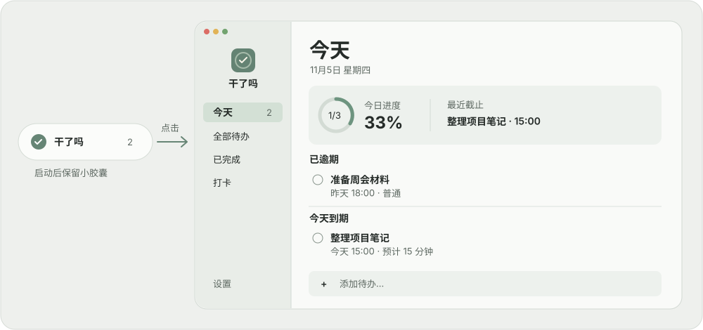

<p align="center">
  
</p>

# 干了吗

**启动后留在桌面一侧，点一下就打开主窗口。**

说一句「明天下午三点交报告」，核对任务和截止时间后保存。需要专注时，从任务旁启动 25 或 50 分钟计时。面板收起后，剩余时间还看得见。

[**下载干了吗 0.8.1**](https://raw.githubusercontent.com/lee73201/ganlema/main/Backups/0.8.1-capsule-entry/ganlema-0.8.1-build14-app.zip) · macOS 14 或更新版本 · 此下载包适用于 Apple 芯片 Mac

## 界面预览



*界面样式示意。启动时只显示小胶囊，点击后打开主窗口。图中的任务为示例。*

## 安装与打开

1. 下载并解压 ZIP，将「干了吗.app」拖入「应用程序」，然后双击打开。
2. 双击应用后，在桌面一侧找到小胶囊。悬停可速览待办，点击打开主窗口，默认进入「今天」。菜单栏勾号也可以分别打开主窗口或悬浮面板。
3. 若 macOS 因无法验证开发者而阻止打开，此构建使用临时签名，未经过 Apple 公证。仅在确认来源为本仓库后，可前往「系统设置 → 隐私与安全性」，在对应提示下选择「仍要打开」（如果系统提供该选项）。

## 怎么用

主窗口的左侧有「今天」「全部待办」「已完成」和「打卡」。在「今天」可以查看今日进度、最近截止、已逾期和今天到期的任务。没有截止时间但今天新增的任务也单独列出。点右上角放大镜可搜索标题、备注或类别。

主窗口和悬浮面板共享任务、习惯和专注状态。点红色关闭按钮或按 `⌘W` 关闭主窗口后，胶囊仍可使用。要退出整个应用，选择菜单栏的「退出干了吗」。

| 想做什么 | 怎么操作 |
| --- | --- |
| 查看、移动或收起 | 悬停约 250 毫秒展开速览，移开约 550 毫秒收起。点击胶囊或速览右上角的打开按钮可进入主窗口。图钉可以固定或解锁速览。拖动胶囊或时钟区域可移动位置，拖动展开窗口边缘或右下角可调整大小。 |
| 写一句话添加 | 在底部输入「明天下午三点交报告，提前半小时提醒」并按回车。检查生成的卡片，再点「确认并保存」。可以用分号分隔多件事。 |
| 说一句话添加 | 点底部麦克风，首次使用时允许麦克风和语音识别。说完点「结束录音」，核对或修改文字，再点「解析待办」并确认保存。 |
| 修改、完成或撤销 | 在列表中点击标题、日期或旗帜即可快速修改。点任务左侧的圆圈标记完成；可在「已完成」恢复。误删任务或打卡时，10 秒内可撤销。 |
| 开启提醒 | 在任务里设置截止时间，勾选提前 1 天、提前 2 小时、到期时或自定义提醒。点面板铃铛查看权限。若通知已关闭，点「打开通知设置」，在 macOS 中为「干了吗」允许通知。 |
| 专注一件事 | 在任务的计时菜单选 25 或 50 分钟。展开时可以暂停、继续或结束，收起后胶囊显示剩余时间。 |
| 记录打卡 | 在「打卡」添加习惯，点击相应日期切换状态。「已完成」按日期汇总完成的待办和已打卡记录。 |
| 调整外观 | 主窗口左侧「设置」→「应用主题」切换跟随系统、浅色或深色。下方「胶囊外观」单独调整桌面胶囊的形状、大小、材质、透明度和展开延时。 |
| 固定待办并看清后方内容 | 点图钉固定面板，再点旁边的半圆图标。拖动滑块可调背景不透明度，数值越低越透。文字、图标和按钮维持原有清晰度，应用会记住设置。 |
| 暂时让它离开屏幕 | 若只想收起面板，先解锁图钉，再移开鼠标。若希望桌面连胶囊也不显示，在菜单栏勾号里选「退出干了吗」。下次打开，任务和打卡仍在。 |

### 有一小段空闲，或者刚被打断

- **现在做哪件**。在「待办」列表顶部打开这个入口，选 5、15、25 或 50 分钟。点任务行里的「估时」设置预计用时。推荐优先从能在空档内完成的待办中按截止紧迫程度、优先级挑选。没有符合时长的估时任务时，可能建议从一项未估时任务先做一步。点推荐卡上的按钮即可开始专注。
- **从这里继续**。暂停专注后，可以留一句下一步，例如「核对报告第三页」。备注自动保存在本机，重新打开应用仍可查看。继续计时后，备注会显示在专注条上，直到本次专注结束。
- **安静胶囊**。从菜单栏勾号或面板齿轮开启。胶囊收起后只显示月亮图标，悬停不会展开。点击胶囊或从菜单栏打开主窗口仍可查看待办；关闭安静模式即恢复原来的悬停设置。共享屏幕时如需同时隐藏系统通知，请使用 macOS 的专注模式。

固定面板的玻璃背景可调 35%–100%，与收起胶囊的外观分开保存。低不透明度时，面板会随明暗主题补一层底色，让文字保持可读。取消固定后，普通悬停面板恢复原来的背景；macOS 开启「降低透明度」时，固定面板优先遵从系统设置。

### 截止时间越近，提醒越明显

默认尺寸下，展开面板会随最紧迫任务的截止时间分级放大。若手动调整过窗口大小，应用优先保留你的尺寸。可在齿轮菜单关闭「DDL 临近时增大窗口」，也可选「恢复默认窗口大小」重新使用自动尺寸。系统提醒是否显示取决于 macOS 通知权限和专注模式等设置。

### 数据与语音

待办和打卡保存在本机，无需注册账号。文字解析在本机运行，支持常用中文日期、时段和提前提醒。遇到含糊的时间，请在保存前核对卡片。语音转文字使用 Apple 的系统能力，设备支持时优先在本机识别，否则可能由 Apple 联网处理。应用不保存录音文件。

## 从源码构建

这是原生 macOS 应用。界面使用 SwiftUI，悬浮窗和毛玻璃由 AppKit 提供，本地记录使用 SwiftData。安装完整 Xcode 后，在仓库目录运行：

```bash
bash scripts/test.sh
bash scripts/build-app.sh
open "build/干了吗.app"
```

也可以打开 `FocusDock.xcodeproj`，选择 `FocusDock` scheme 运行或测试。透明底图标源文件位于 [Resources/AppIcon.png](Resources/AppIcon.png)，应用使用 [AppIcon.icns](Resources/AppIcon.icns)。

- 本机数据库位于 `~/Library/Application Support/FocusDock/`。升级时沿用原应用标识和数据路径，迁移细节见 [MIGRATION.md](MIGRATION.md)。
- [历史版本备份](Backups)和[本次验证记录](VALIDATION-0.8.1.md)保留在仓库中。应用下载包不包含个人数据库。
